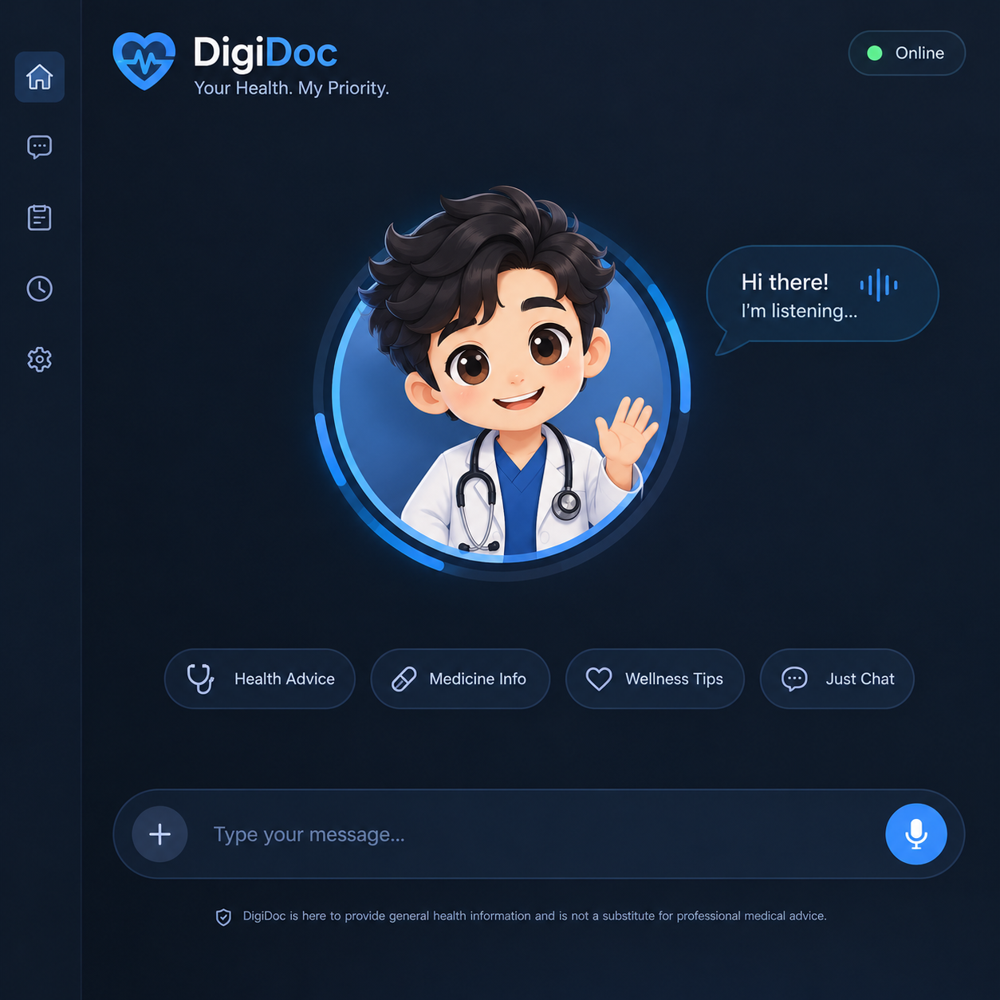

<div align="center">


# DigiDoc

### Urdu-First AI Healthcare Consultant & Care Navigator for Quetta and Balochistan

*Speak in Urdu, Roman Urdu or English. Get safe triage guidance, understand your lab reports, and find the right doctor, all in one voice-first experience.*


**[Live Demo](#)** · **[Demo Video](#)** · **[Presentation](#)**

</div>

---

## Table of Contents

1. [Problem Statement](#1-problem-statement)
2. [Our Solution](#2-our-solution)
3. [Key Features](#3-key-features)
4. [How It Works](#4-how-it-works)
5. [Tech Stack](#5-tech-stack)
6. [AI Tools Used to Build DigiDoc](#6-ai-tools-used-to-build-digidoc)
7. [Project Structure](#7-project-structure)
8. [Knowledge Base & Datasets](#8-knowledge-base--datasets)
9. [Getting Started](#9-getting-started)
10. [Safety, Privacy & Responsible AI](#10-safety-privacy--responsible-ai)
11. [Limitations](#11-limitations)
12. [Roadmap](#12-roadmap)
13. [Team](#13-team)

---

## 1. Problem Statement

Access to quality healthcare in Balochistan is difficult. Many patients face the same barriers:

- **Language barrier:** most digital health tools are English-only, while many patients speak and think in Urdu or Roman Urdu.
- **Low health literacy:** patients struggle to describe symptoms clearly or understand a lab report.
- **No guidance on urgency:** people do not know whether their symptoms need the emergency room today or a routine visit next week.
- **Hard to find the right doctor:** there is no simple way to know which specialist to see, or where and how to contact them in Quetta.

## 2. Our Solution

**DigiDoc** is a voice-first AI healthcare consultant with an animated avatar. It talks with the patient in natural Urdu, asks one adaptive question at a time, detects dangerous warning signs, explains lab results in simple language, and recommends matching specialists from a Quetta doctors directory with hospital, address, and phone number.

> DigiDoc is a **care-navigation and patient-preparation tool**. It does not replace a doctor, does not prescribe medicine, and does not give a final diagnosis.

<div align="center">

</div>

---

## 3. Key Features

### Voice-First Conversation
- Hands-free **continuous voice mode** with live transcription of what the user is saying.
- **Barge-in support:** the user can interrupt the avatar while it is speaking.
- Built-in noise suppression, echo cancellation, and voice-activity detection using the Web Audio API.
- Language toggle between **Urdu (ur-PK)** and **English**, plus a text-input fallback.

### Expressive Avatar
- Custom-designed character created with **ChatGPT**, with a full **avatar style sheet** to keep the look consistent.
- Two animation videos made with **Google Flow** and integrated into the app: a **micro-reaction video** and a **speaking animation video**.
- Avatar states: `idle`, `listening`, `thinking`, `speaking`, `alert`.
- The AI embeds reaction tags such as `[NOD_EMPATHETIC]`, `[THINKING_ANALYZING]`, `[SPEAKING_REASSURING]`, `[ALERT_URGENT]` and `[WARM_SMILE]`. The UI reads them to drive the avatar's micro-reactions.

### Adaptive Symptom Intake
- Asks **one question at a time** and never repeats a question already asked.
- Compares the top two possible conditions and asks the symptom that best tells them apart.
- Understands **negation** in three scripts, for example "bukhar nahi hai" or "بخار نہیں ہے" means no fever.
- Detects whether the patient is getting **better or worse** during the conversation.

### 4-Tier Triage and Emergency Detection
| Tier | Meaning | Action |
|:---:|---|---|
| 1 | Emergency | Call Rescue **1122** or go to the nearest ER immediately |
| 2 | Urgent | See a doctor within 24 hours |
| 3 | Routine | Book a normal appointment |
| 4 | Self-care | Supportive home care |

- 16 rule-based **red-flag rules** (chest pain, breathing difficulty, stroke signs, and more) trigger an on-screen **Emergency Banner**.
- Vulnerable groups (child under 5, adult over 65, pregnancy, chronic illness) automatically get a higher urgency tier.

### Lab Report Analyzer
- Searchable database of **424 clinical tests**.
- Evaluates a value against **age, sex and pregnancy** specific reference ranges.
- Flags **critical (panic) values** as emergencies and explains results in Urdu.
- One click to ask DigiDoc about a result in the chat.

### Quetta Doctors Directory
- **291 doctors and clinics** across Quetta with specialty, hospital or clinic, address, area, and phone number.
- Search by name, specialty, hospital or area, and filter by specialty.
- The AI recommends *which* specialist is needed and *why*, then points to matching doctors.

### Resilient AI Layer (Never Goes Down)
DigiDoc uses a three-level fallback so it keeps working even without internet or API keys:
1. **Groq** (ultra-fast), trying several models in order, with automatic failover.
2. **Google Gemini** (`gemini-2.5-flash`, then `gemini-2.0-flash`).
3. **Offline local clinical engine**, a fully rule-based engine that works with no API key at all.

### Other
- Conversation transcript drawer, quick-action shortcuts (Health Advice, Medicine Info, Wellness Tips), settings modal, and a responsive PWA-ready layout with manifest and icons.

---

## 4. How It Works

```
 Patient speaks / types (Urdu · Roman Urdu · English)
                    │
                    ▼
        ┌───────────────────────┐
        │   Speech Service       │  Web Speech API + noise suppression + VAD
        └───────────┬───────────┘
                    ▼
        ┌───────────────────────┐
        │   Clinical State       │  symptom extraction · negation · differential
        │   Manager              │  scoring (noisy-OR) · red-flag rules
        └───────────┬───────────┘
                    ▼
        ┌───────────────────────┐        ┌─────────────────────────┐
        │   AI Service           │ ─────▶ │ Groq → Gemini → Offline │
        │   (system prompt +     │        │ Clinical Engine         │
        │    clinical grounding) │        └─────────────────────────┘
        └───────────┬───────────┘
                    ▼
   Reaction tags parsed ─▶ Avatar animates ─▶ Reply spoken back (TTS)
                    │
                    ├─▶ Emergency Banner (if red flag)
                    ├─▶ Doctor recommendation (Quetta directory)
                    └─▶ Lab interpretation (424 tests)
```

**5-step consultation workflow:** Greeting and chief complaint → adaptive intake (one question at a time) → analysis of symptoms and labs → specialist recommendation → booking guidance, with a safety disclaimer at the end.

---

## 5. Tech Stack

| Layer | Technology |
|---|---|
| Frontend | React 19, Vite 8, JavaScript (ES Modules), CSS, Lucide Icons |
| Voice | Web Speech API (recognition and synthesis), Web Audio API (analyser, VAD, noise suppression) |
| AI / LLM | Groq API (Qwen, GPT-OSS, Llama models), Google Gemini API |
| Clinical Logic | Custom rule-based clinical engine and state manager (symptom matching, negation, noisy-OR scoring, red-flag rules) |
| Data | Curated JSON knowledge bases (diseases, doctors, lab ranges) |
| Tooling | Oxlint, npm |
| Design and Media | ChatGPT (avatar and style sheet), Google Flow (avatar videos) |
| Development | Google Antigravity |
| Extras | MCP server scaffold and architecture documentation (see `DIGIDOC_DOCUMENTATION/`) |

---

## 6. AI Tools Used to Build DigiDoc

DigiDoc was built as a team using a modern AI-assisted workflow. Each tool had a clear role:

| Purpose | Tool | What we did with it |
|---|---|---|
| **Avatar creation and style sheet** | **ChatGPT** | Designed the DigiDoc avatar character and created the avatar style sheet so the character stays visually consistent |
| **Character motion (video)** | **Google Flow** | Created two videos from the avatar: a *micro-reaction* video and a *speaking animation* video, both integrated into the app's avatar portal |
| **Research and data collection** | **Claude** | Researched and compiled the doctors directory, disease and symptom knowledge, lab reference ranges, and contact phone numbers |
| **Integration and development** | **Google Antigravity** | Integrated the frontend, clinical engine, data, AI services, and avatar videos into one working application |

---

## 7. Project Structure

```
DigiDOC/
├── public/
│   └── assets/
│       ├── videos/               # Avatar animations (speaking, micro-reaction)
│       └── digidoc-mockup.png
├── src/
│   ├── components/               # AvatarPortal, Sidebar, Header, ChatInputBar,
│   │                             # EmergencyBanner, DoctorsModal, LabAnalyzerModal,
│   │                             # SettingsModal, ConversationDrawer, QuickActions
│   ├── services/
│   │   ├── geminiService.js      # LLM orchestration (Groq → Gemini → offline)
│   │   ├── clinicalEngine.js     # Offline engine, adaptive follow-up questions
│   │   ├── clinicalState.js      # Symptom extraction, negation, differential scoring
│   │   └── speechService.js      # Voice input/output, VAD, barge-in
│   ├── data/                     # JSON knowledge bases
│   ├── App.jsx
│   └── main.jsx
├── data/                         # Source datasets
├── DIGIDOC_DOCUMENTATION/        # Full spec, MCP server scaffold, architecture docs
├── index.html
├── package.json
└── vite.config.js
```

---

## 8. Knowledge Base & Datasets

| Dataset | Contents |
|---|---|
| `diseases_conditions.json` | **87 symptoms**, **41 conditions**, **18 specialties**, **16 red-flag rules**, with keywords in Urdu script, Roman Urdu and English |
| `quetta_doctors.json` | **291** doctor and clinic records for Quetta |
| `lab_reference_ranges.json` | **424 lab tests** with age, sex and pregnancy ranges, and critical limits |

The conditions include region-relevant illnesses such as dengue, malaria, typhoid, cholera, CCHF, leishmaniasis, hepatitis, TB, and heat stroke, as well as common conditions such as diabetes, hypertension, asthma, and UTI.

---

## 9. Getting Started

### Prerequisites
- Node.js 18 or newer
- A modern Chromium-based browser (Chrome or Edge) for best Urdu voice recognition
- *(Optional)* a free [Groq](https://console.groq.com) or [Google Gemini](https://aistudio.google.com) API key

### Installation

```bash
# 1. Clone the repository
git clone <YOUR_GITHUB_REPO_URL>
cd DigiDOC

# 2. Install dependencies
npm install

# 3. Start the development server
npm run dev
```

Open **http://localhost:5173** in your browser.

### Configure the AI (Optional)

You can run DigiDoc with **no key at all**, because the offline clinical engine takes over. For full AI responses, add your own free [Groq](https://console.groq.com) or [Google Gemini](https://aistudio.google.com) key in one of these ways:

**Option A (recommended): In the app.** Click **Settings** and paste your own API key. Groq keys start with `gsk_`, and anything else is treated as a Gemini key. The key stays only in your own browser and is never part of the code or the repository.

**Option B: Local environment file (development only).** Create a `.env` file in the project root:

```env
VITE_GROQ_API_KEY=your_groq_key_here
VITE_GEMINI_API_KEY=your_gemini_key_here
```

> **Security warning: never expose your API key publicly.**
> - **No API keys are included in this repository.** Never commit real keys to GitHub.
> - `.env` files are already listed in `.gitignore`, so they are not uploaded. Keep it that way.
> - Anything starting with `VITE_` is bundled into the browser code at build time. **Do not deploy a public website built with a real key in `.env`**, because anyone can read it from the browser. For a public demo, leave the `.env` empty and let users enter their own key in Settings, or use the offline mode.
> - If a key is ever leaked or pushed by mistake, **revoke it immediately** in the Groq or Google AI Studio dashboard and create a new one.

### Available Scripts

| Command | Description |
|---|---|
| `npm run dev` | Start the development server |
| `npm run build` | Create a production build |
| `npm run preview` | Preview the production build |
| `npm run lint` | Run Oxlint |

---

## 10. Safety, Privacy & Responsible AI

- **Not a medical device.** DigiDoc gives guidance and navigation only. It never prescribes medicines or gives a definitive diagnosis, and it ends advice with a reminder to consult a qualified doctor.
- **Safety-first design.** Emergency red flags override the normal interview and immediately advise calling Rescue 1122 or going to the nearest hospital.
- **Grounded answers.** The AI is instructed to rely on the project's curated clinical data rather than inventing doctors, numbers, or lab ranges.
- **Privacy.** Conversations run in the browser. API keys entered in Settings are stored only in the user's own browser `localStorage`, and no keys are stored in the repository. No patient accounts or server-side health records exist in this prototype.
- **Transparency about the directory.** Each doctor record carries a verification status and source link. Patients should confirm details with the clinic before visiting.

---

## 11. Limitations

We want to be honest about the current prototype:

- The triage rules and symptom data are **not yet clinically validated** by licensed doctors.
- The doctors, disease, and lab data were researched with AI assistance and compiled from public listings. Many doctor records are marked *"Needs direct verification"*. Phone numbers and availability may change.
- Appointment booking is **guidance only** (the doctor's contact details are shown). There is no live scheduling integration yet.
- Urdu speech recognition quality depends on the browser and device.
- The LLM can make mistakes, so its output must not be treated as medical advice.

---

## 12. Roadmap

- [ ] Clinical review and validation of triage rules by licensed physicians
- [ ] Verified doctor profiles and real appointment scheduling
- [ ] Secure backend with user accounts and consent-based record storage
- [ ] Upload and OCR of lab reports and prescriptions
- [ ] Dedicated Urdu speech-to-text and text-to-speech providers for better accuracy
- [ ] Expansion to other Pakistani languages (Pashto, Balochi, Brahui) and other cities
- [ ] Reminders and follow-up check-ins
- [ ] Mobile app (PWA and native)

---

## 13. Team

**Team Leader: Inam Ali Soomro**

| Member | Role | Contributions |
|---|---|---|
| **Inam Ali Soomro** (Team Leader) | Backend, UI/UX, Video, Presenter | Backend and clinical logic, UI/UX design, avatar flow video creation, project leadership, project presenter |
| **Muhammad Haris** | Backend, AI/ML Engineer | Backend development, AI/ML engineering, AI service and data integration |
| **Hamad Ahmed Rana** | Frontend, UI/UX, Research, Documentation | Frontend development, UI/UX design, medical and data research, project documentation |
| **Abdul Ahad Khan** | Frontend, Design, AI/ML Engineer, Research, Documentation | Frontend style sheets, logo design, color theme, AI/ML engineering, medical and data research, project documentation |

---

## Disclaimer

DigiDoc is a hackathon prototype built for educational and demonstration purposes. It is **not** a substitute for professional medical advice, diagnosis, or treatment. In an emergency, call **Rescue 1122** or go to the nearest hospital immediately.

<div align="center">

Made with care in Quetta, Balochistan, Pakistan

</div>
